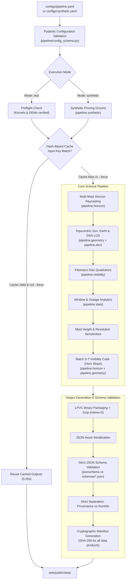

# LightPath Data Processing Pipeline (`pipeline.run`)

This document defines the architecture, data flow, serialization formats, validation mechanisms, and maintenance procedures for the LightPath data processing pipeline.

---

## 1. Architecture & Data Flow Overview

The LightPath pipeline transforms configuration files and raw planetary datasets (LOLA DEMs and NAIF SPICE kernels) into static, highly compressed JSON and binary assets consumed directly by the web application.



---

## 2. Execution Modes: Real vs Synthetic

| Feature | Real Mode (`--mode real`) | Synthetic Mode (`--mode synthetic`) |
| :--- | :--- | :--- |
| **Target Dataset** | NASA PDS LOLA GDR/RDR elevation products | Deterministic geometric surfaces (crater, wall, cone, flat) |
| **Ephemeris** | NAIF SPICE DE440 / MOON_ME via `kernels/meta.tm` | Analytical lunar libration & orbital ephemeris |
| **Preflight Policy** | **Refuses to execute** if kernels or DEMs are missing | Runs end-to-end on clean checkout without external network |
| **Flagging** | Real metadata; `verified` false unless checked | Permanent `is_synthetic: true` on all products & UI banners |
| **Use Case** | NASA CLPS site assessment & scientific review | Offline development, automated CI testing, UI testing |

### Real Mode Preflight Rejection
If any required kernel or DEM file is missing, the pipeline prints actionable download instructions and exits with code 1:
```text
======================================================================
ERROR: LightPath Mode 'real' refused to execute due to missing required files:
  - DEM raster missing for site 'shackleton-connecting-ridge': data/raw/lola_shackleton_20m.tif
INSTRUCTIONS:
  1. Fill required URLs in kernels/kernels.json and run 'python scripts/fetch_kernels.py'.
  2. Fill PDS links in data/dem_manifest.json and run 'scripts/fetch_dem.py'.
  3. Alternatively, run with '--mode synthetic' to run the synthetic proving ground.
======================================================================
```

---

## 3. Serialization Formats & Output Layout

All pipeline assets are written under `web/public/data/`:

```text
web/public/data/
├── index.json                     # Global catalog (sites summary, missions, mode)
├── sites.json                     # Lightweight site summaries array
├── manifest.json                  # Cryptographic SHA-256 hashes of all assets
├── test_results.json              # Pytest verification suite report for Trust page
├── sites/
│   ├── {site_id}.json             # Full site record: metadata, stats, sensitivities
├── cubes/
│   ├── {site_id}.json             # Visibility cube JSON header (grid, times, bounds)
│   └── {site_id}.bin              # Gzipped binary spatio-temporal visibility cube
└── {site_id}/
    ├── site.json                  # Full site record
    ├── horizon.json               # Multi-mast horizon profile
    ├── series.json                # Sun, Earth, DTE time-series
    ├── stats.json                 # Window statistics and outage metrics
    ├── visibility_cube.json       # Route planning visibility cube
    ├── provenance.json            # Deterministic dataset provenance & parameters
    └── run_info.json              # Execution-time metadata (timestamps, git commit)
```

### Binary Visibility Cube Format (`LPVC`)
Route planning traversability grids are packaged into high-performance binary files (`cubes/{site_id}.bin`) compressed via `gzip` with `mtime=0.0` for reproducibility:

```text
+-----------------------+---------+-----------------------------------------------------+
| Field                 | Type    | Description                                         |
+-----------------------+---------+-----------------------------------------------------+
| Magic Bytes           | 4 bytes | b"LPVC" (LightPath Visibility Cube)                 |
| Version               | uint16  | Format version (1)                                  |
| nx                    | uint16  | Grid cell count along X (East)                      |
| ny                    | uint16  | Grid cell count along Y (North)                     |
| nt                    | uint16  | Number of time steps in cube window                 |
+-----------------------+---------+-----------------------------------------------------+
| sun_frac              | uint8[] | nt * ny * nx bytes: Sun disc fraction (0 - 100%)    |
| earth_frac            | uint8[] | nt * ny * nx bytes: Earth disc fraction (0 - 100%)  |
| slope_deg             | uint8[] | ny * nx bytes: Horn terrain slope (0 - 90 deg)      |
| traversable           | uint8[] | ny * nx bytes: Boolean mechanical traversability    |
+-----------------------+---------+-----------------------------------------------------+
```

### Grid Cell Capping
To ensure fluid performance in browser Web Workers and prevent memory exhaustion, grids exceeding `max_cells` (default 4000) are automatically coarsened:
$$\Delta x_{\text{capped}} = \left\lceil \sqrt{\frac{(2 \cdot \text{half\_width\_m})^2}{\text{max\_cells}}} \right\rceil$$
The header explains the cap under `cell_cap_explanation`.

---

## 4. Determinism & Provenance Separation (Requirement V6)

To ensure scientific reproducibility, LightPath strictly isolates execution-time variance:

1. **Simulation Data Files**: `horizon.json`, `series.json`, `stats.json`, `visibility_cube.json`, `cubes/{id}.bin`, `site.json`, `sites/{id}.json`, `provenance.json`, `index.json`, `manifest.json`.
   - Contain **zero wall-clock timestamps**.
   - Timestamps reflect purely the simulated mission interval (`date_range.start_utc`).
   - Gzip compression enforces `mtime=0.0`.
2. **Execution Metadata (`run_info.json`)**:
   - Contains dynamic execution wall-clock time (`created_utc`, `start_utc`, `end_utc`), execution duration, git commit, and runtime library versions.
   - Kept strictly separate from the deterministic manifest.

> [!IMPORTANT]
> **V6 Verification Guarantee**: Two consecutive synthetic pipeline runs produce 100% byte-identical SHA-256 hashes across every file in `web/public/data/` except `run_info.json`. Tested by `tests/test_pipeline_run.py::test_v6_determinism_byte_identical`.

---

## 5. Hash-Based Caching

Each site computes an input cryptographic hash from:
1. Site configuration slice (`lat_deg`, `lon_deg`, `ground_elev_m`, layers).
2. Global parameters (date range, mast heights, thresholds, margins, horizon parameters, route planning grid).
3. Terrain inputs (SHA-256 of DEM files in real mode; synthetic feature type in synthetic mode).
4. Kernel pool meta-kernel hash.

If `.cache_key` matches and all output files exist, the pipeline reuses cached outputs in $< 0.1\text{ s}$.
Use the `--force` flag to bypass the cache and force recomputation:
```bash
python -m pipeline.run --config configs/synthetic.yaml --mode synthetic --force
```

---

## 6. How a Human Updates the Data

### A. Updating SPICE Kernels
1. Inspect official NAIF JPL repositories for updated planetary ephemeris (DE440 / DE442) and lunar orientation frames (`moon_pa_de440_200108.bpc`, `pck00011.tpc`, `naif0012.tls`).
2. Add kernel filename, NAIF download URL, and SHA-256 to `kernels/kernels.json`.
3. Run download script:
   ```bash
   python scripts/fetch_kernels.py
   python scripts/make_meta_kernel.py
   ```

### B. Adding Real Lunar DEM Rasters
1. Download LOLA South Pole Elevation products (e.g. 20m/px or 5m/px polar stereographic GeoTIFFs) from the NASA Planetary Data System (PDS) Geosciences Node or GSFC PGDA:
   - Reference sphere: $R = 1,737,400\text{ m}$.
   - Projection: Polar Stereographic (`+proj=stere +lat_0=-90 +lat_ts=-90 +lon_0=0 +R=1737400 +units=m`).
2. Place rasters under `data/raw/` and record source URLs and checksums in `data/dem_manifest.json`.
3. Add layer configuration to `configs/pipeline.yaml` under `sites[].terrain_layers`.

### C. Adding a New Landing Site
Add an entry to `configs/pipeline.yaml`:
```yaml
  - id: new-clps-site
    name: "Candidate Ridge Site"
    lat_deg: -89.45
    lon_deg: 120.50
    ground_elev_m: 850.0
    verified: false
    is_synthetic: false
    mission_ids: ["clps-to-2026"]
    source_links:
      - "https://pds-geosciences.wustl.edu/missions/lro/lola.htm"
    terrain_layers:
      - name: "fine_20m"
        path: "data/raw/lola_site_20m.tif"
        max_range_m: 5000.0
        pixel_size_m: 20.0
```

### D. Updating CLPS Mission Metadata
Edit `data/missions.json` according to official NASA releases. Every entry must validate against `schemas/missions.schema.json`. Real missions must set `verified: true` only after primary source verification.

### E. Executing and Validating the Pipeline
Run the pipeline:
```bash
python -m pipeline.run --config configs/pipeline.yaml --mode real
```
Run verification tests:
```bash
pytest -v
```
All outputs will be validated against strict schemas before exiting.
